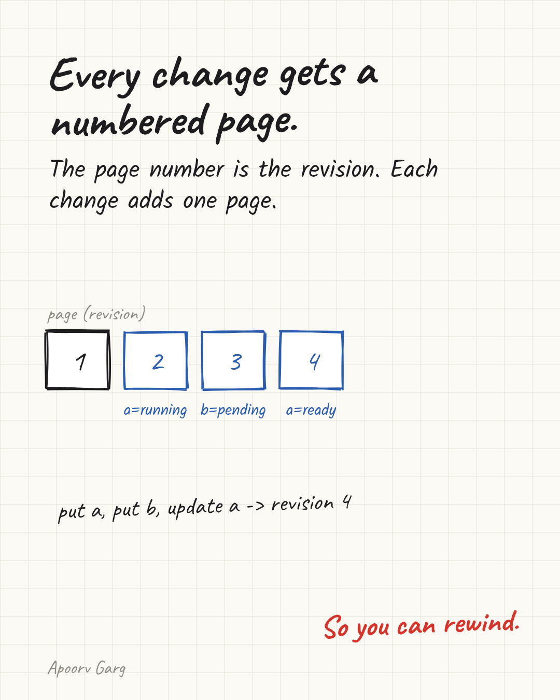
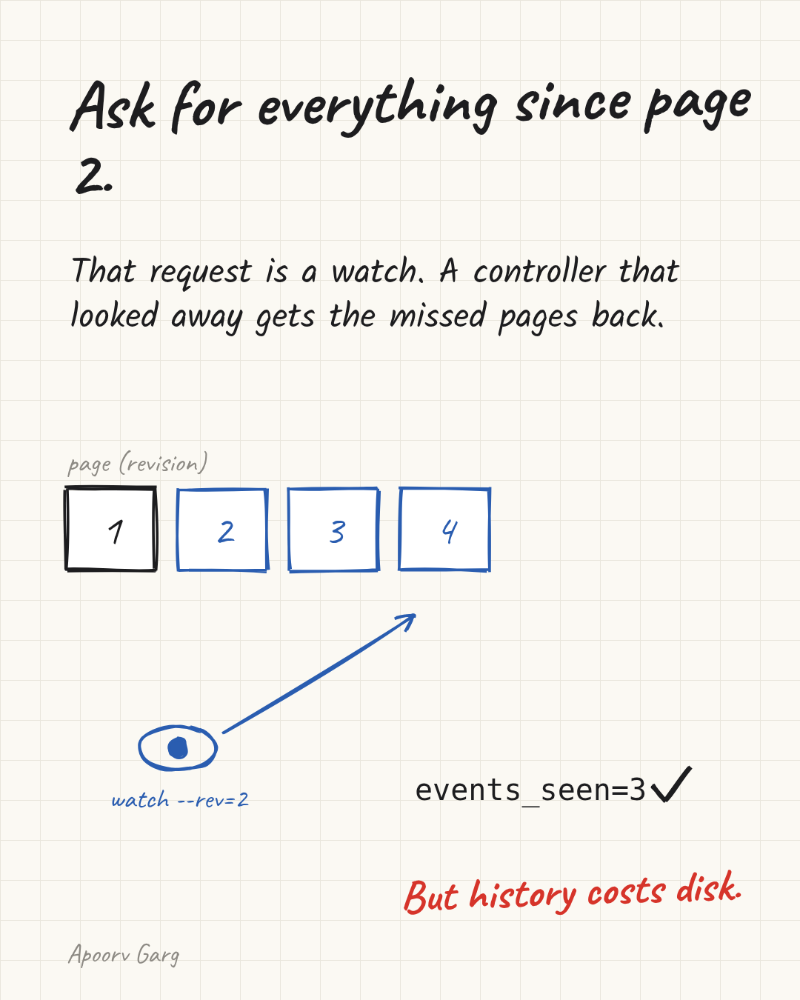
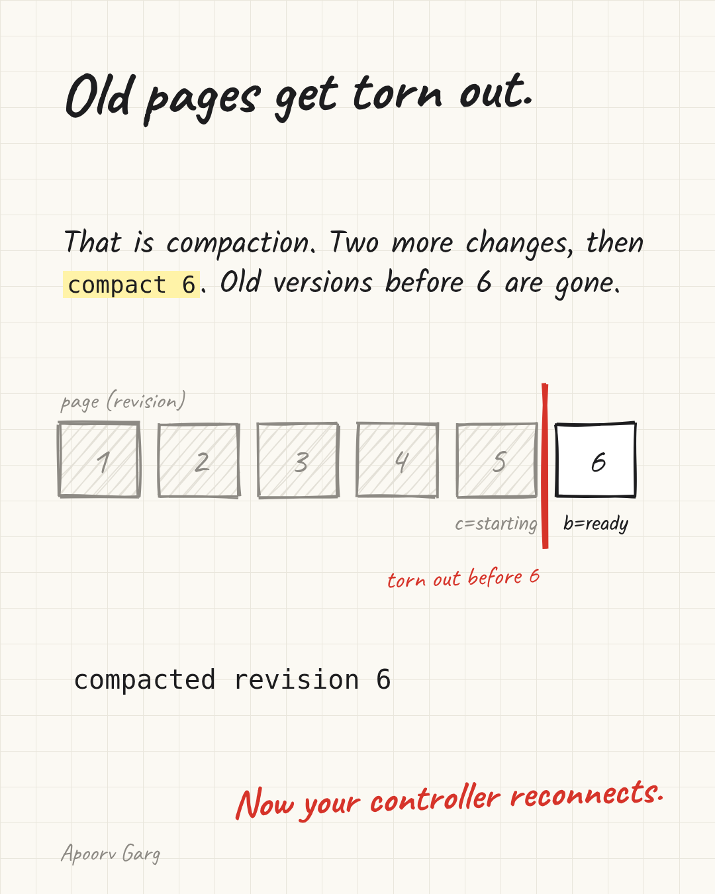
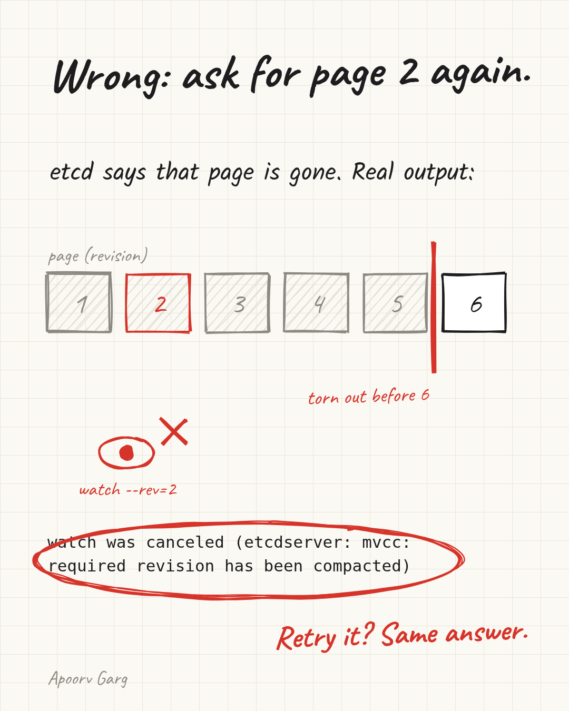
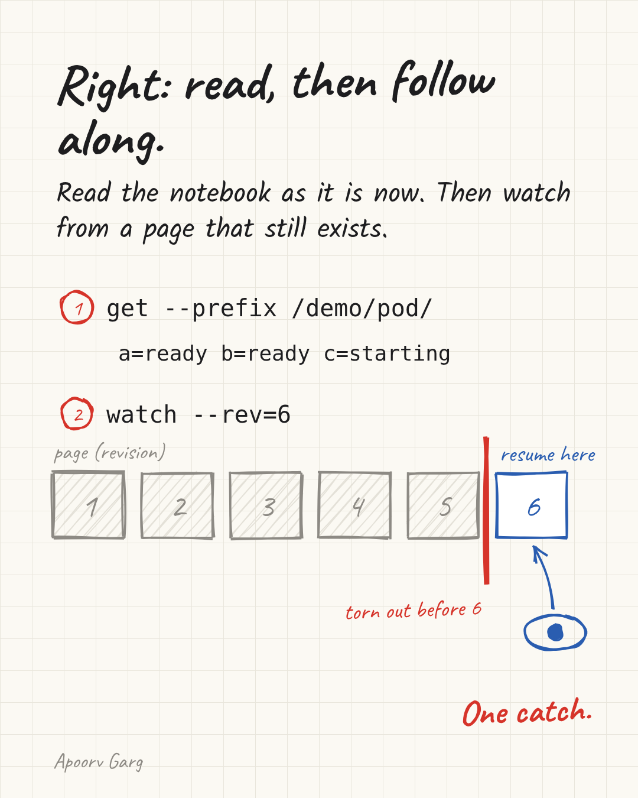
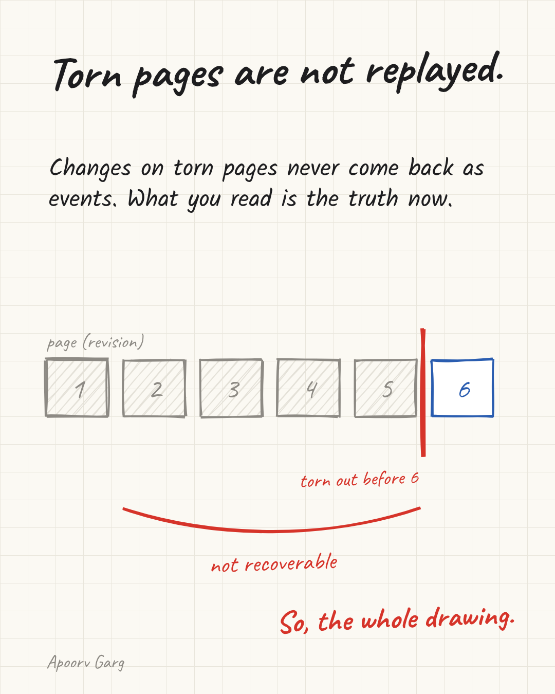

# Your etcd watch died at page 2. Someone tore that page out.

Kubernetes keeps its state in etcd, a small database. Controllers are programs that react when that state changes. Sometimes one looks away, comes back, and etcd says the history it wants is gone. That is not a bug.



## A shared notebook with numbered pages

Think of etcd as a shared notebook. Every change gets a new numbered page. That number is the revision. A fresh notebook starts at page 1. One change adds one page. A batch made together (a transaction) adds only one page. In my demo, three changes took it to page 4.

## Asking for everything since page 2

A controller does not reread the whole notebook. It asks etcd: tell me every change from page 2 on, and keep telling me. That request is called a watch.



If it looks away, it can ask again. etcd replays the missed pages. In the demo it got all 3 changes back.

## Old pages get torn out

A notebook that keeps every page forever fills the shelf. So etcd tears out old pages. That is compaction. The latest value of each key stays. Older versions go.



In my demo, two more changes reached page 6, then I compacted at 6. In Kubernetes this runs on a timer.

## Wrong: ask for page 2 again

Now the controller comes back and asks for "everything since page 2". etcd says that page is gone:

```
watch was canceled (etcdserver: mvcc: required revision has been compacted)
```



In Go this is `ErrCompacted`. Asking again never helps. Page 2 is never coming back. This is a hole in history, not a network hiccup.

## Right: read the notebook, then follow along

The fix has two steps.

1. Read the notebook as it is right now.
2. Follow along from a page that still exists, page 6 in the demo.



What you read in step 1 is now the truth.

## The catch: torn pages are not replayed

Changes on torn pages never come back as events. In the demo, page 5 only shows up because step 1 reads it. Create and delete inside that gap, and you never see it.



## Do you need to care?

If you use Kubernetes informers from client-go, mostly no. When the resume point is too old, they read everything again. Still learn the error for your logs.

If you build your own controller or cache on etcd, yes. Plan for `ErrCompacted`.

## Try it

I ran this on one etcd v3.7.2 node, no Docker:

```
put, put, update        -> revision 4
watch --rev=2           -> 3 events
compact 6               -> compacted revision 6
watch --rev=2           -> required revision has been compacted
get --rev=2 /demo/pod/a -> required revision has been compacted
get --prefix, watch --rev=6 -> works
```

All commands are in the script:

https://github.com/Apoorvgarg-creator/articles-linkedin/tree/main/cncf/etcd-watch-compaction

How does your controller handle ErrCompacted today?
