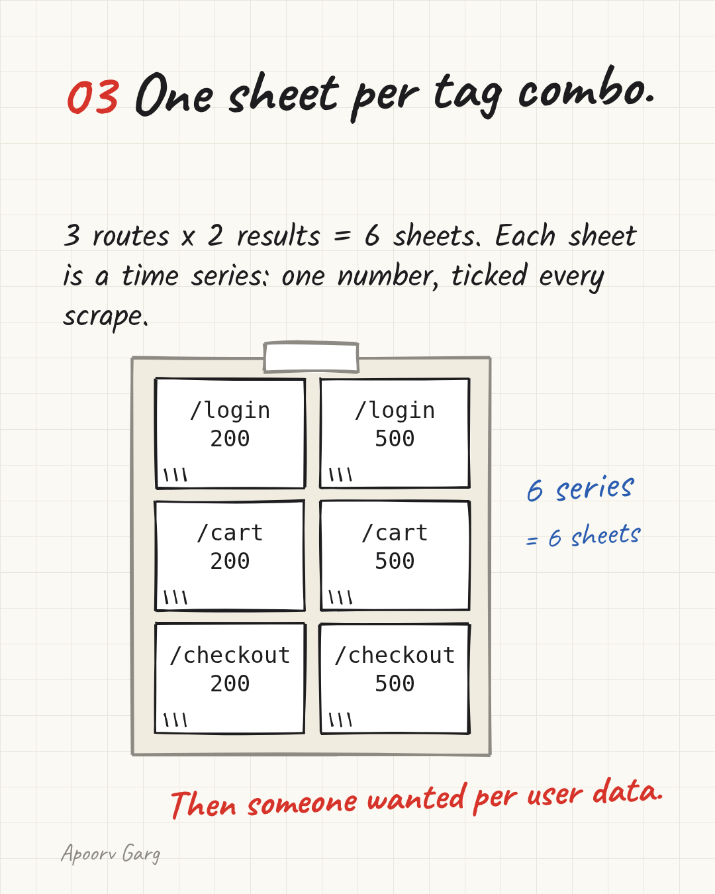
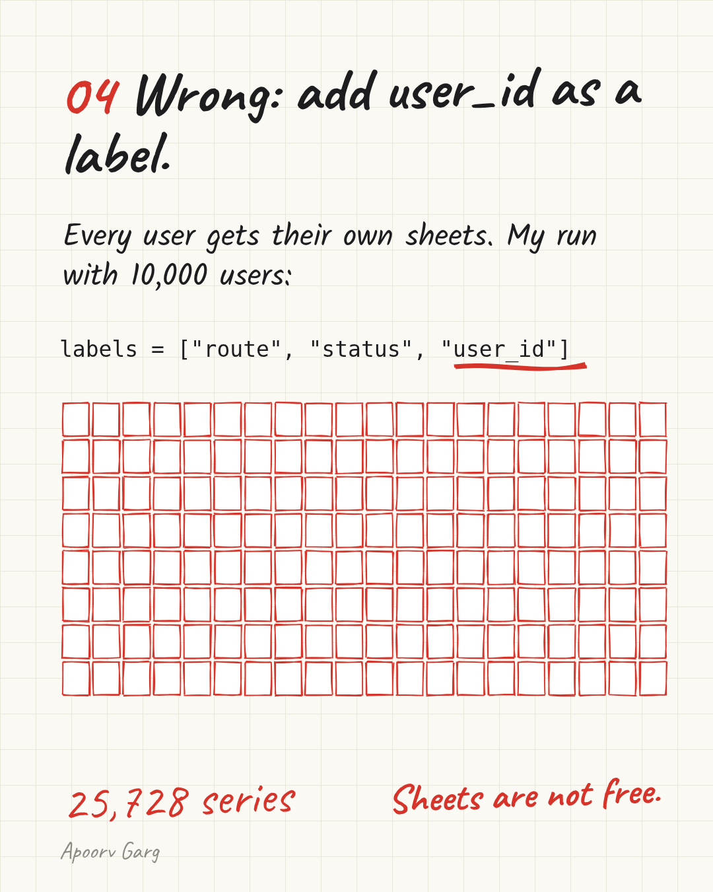
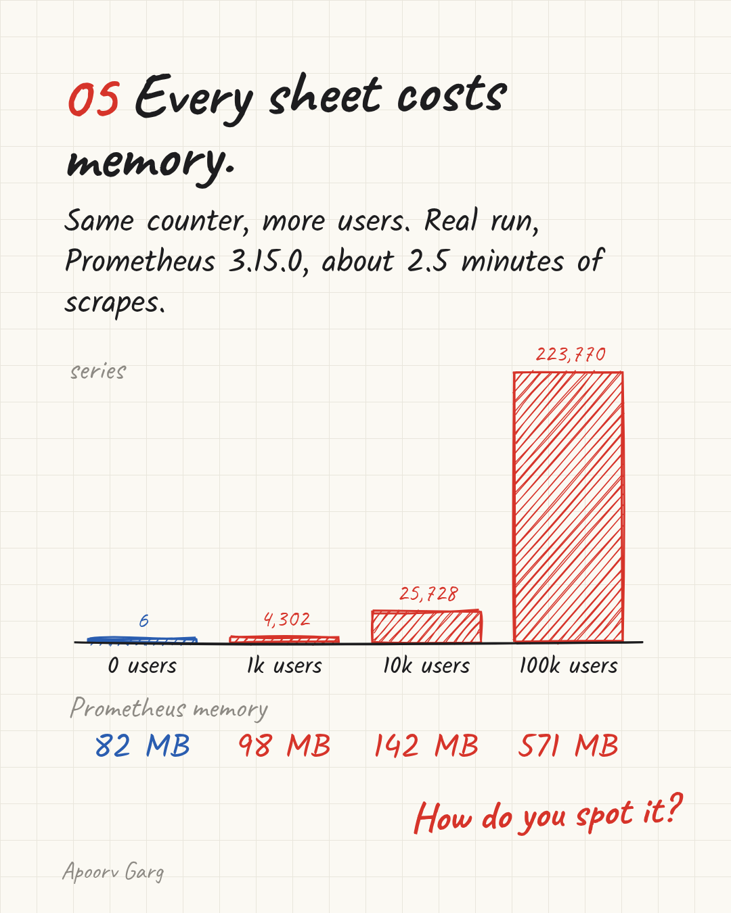
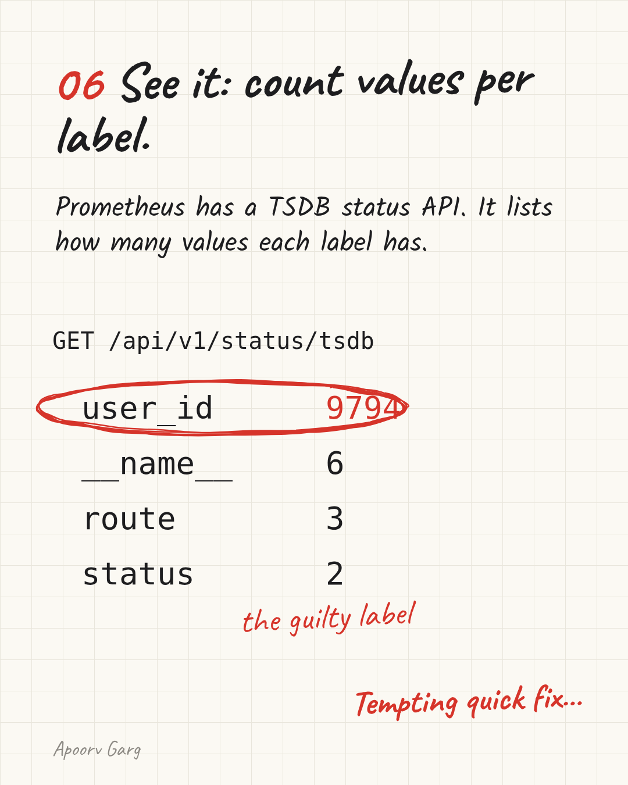
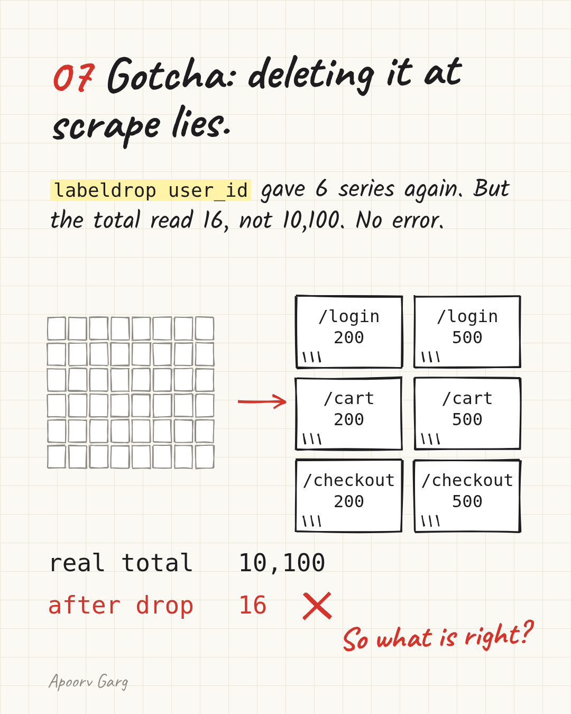
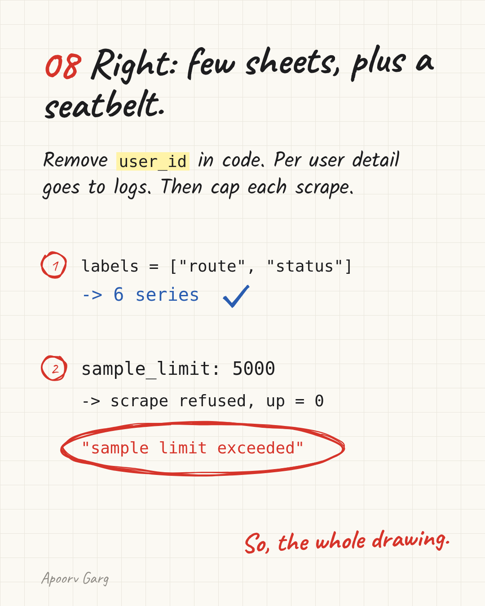

# One user_id label turned 6 Prometheus series into 223,770

I added one label to one counter. Prometheus went from 6 time series to 223,770, and its memory from 82 MB to 571 MB. Nothing crashed. Nothing warned me. The fix: keep per-user detail out of metrics, and put a cap on every scrape so the next mistake fails loudly.

## Three words first

**Prometheus** is an open source monitoring tool, a graduated CNCF project. Every 15 seconds it visits your app's `/metrics` page and writes down the numbers it finds. That visit is a **scrape**.

A **metric** is one named number. `http_requests_total` counts the requests your API handled.

A **label** is a tag on that number. It says which slice it counts: `route="/checkout"`, `status="500"`.

## One tally sheet per tag combo

Picture a clipboard of tally sheets. Prometheus keeps one sheet for every unique combination of labels and adds a tick to each sheet on every scrape. One sheet is one **time series**.

My demo API has 3 routes and 2 results. 3 x 2 = 6 sheets. The number of sheets is called **cardinality**. Here it is 6.



## Wrong: add user_id as a label

Product asks "which users hit errors?" The quick answer is one more label. This line is wrong on purpose:

```python
labels = ["route", "status", "user_id"]
```

Now every user gets their own sheets. With 10,000 users, my run had 25,728 series. Same counter. Same one line of code.



It is sneaky in an early product. With 50 users it costs nothing. The sheets grow with your users, not with your traffic.

## Every sheet costs memory

I ran Prometheus 3.15.0 against four copies of the same small Python app, each with more users, for about 2.5 minutes:

```
users     series    Prometheus memory (RSS)
0              6     82 MB
1,000      4,302     98 MB
10,000    25,728    142 MB
100,000  223,770    571 MB
```

RSS is the RAM the process really holds. In this run each series cost about 2 KB of heap. At 100,000 users one scrape took 2.72 seconds.



Hosted Prometheus bills for this too. Grafana Cloud Pro lists $6.50 per 1,000 active series a month after the first 10,000 (checked 21 Oct 2026). At list price, 223,770 series kept all month is about $1,300. For one counter.

## How to see it

Prometheus stores data in its own time series database, the TSDB. Its status API lists how many values each label has:

```
GET /api/v1/status/tsdb
user_id   9794
route     3
status    2
```

One label with thousands of values is your suspect.



## Gotcha: dropping the label at scrape time lies

Prometheus can rewrite labels while it scrapes. This is called relabeling. Dropping `user_id` there looks like a 2-minute fix. On the 1,000-user app:

- series went from 4,302 to 6
- the real request total was 10,100
- after the drop, the total read 16
- no scrape error

Thousands of sheets got squeezed onto 6 names, so the numbers stopped meaning anything. The Prometheus docs warn that series must stay unique after `labeldrop`.



## Right: few sheets, plus a seatbelt

1. **Remove `user_id` in code.** Keep route and status. Back to 6 series. Per-user detail goes to logs, where one line per request is normal.
2. **Add `sample_limit` to the scrape config.** With `sample_limit: 5000`, Prometheus refused the 10,000-user scrape and reported `sample limit exceeded`. `up`, the series Prometheus writes for every target, went to 0. You can alert on that.



The tradeoff: when the seatbelt trips, you lose all metrics from that app until someone fixes it. Set the limit well above your normal sample count. A loud gap beats a quiet bill.

## When to care

A label with 3 values is fine. The Prometheus docs suggest keeping most metrics under 10 label combos and rethinking anything that can pass 100. Watch any label whose values grow with your users, orders or requests: user IDs, emails, URLs with IDs inside.

## Try it

One script, no Docker, about 3 minutes. Prometheus 3.15.0 plus a small Python app:

https://github.com/Apoorvgarg-creator/articles-linkedin/tree/main/cncf/prometheus-label-cardinality

Which label in your metrics grows with your users?
